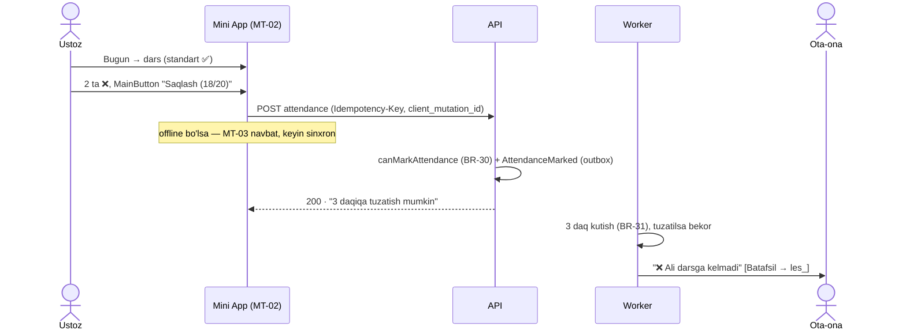
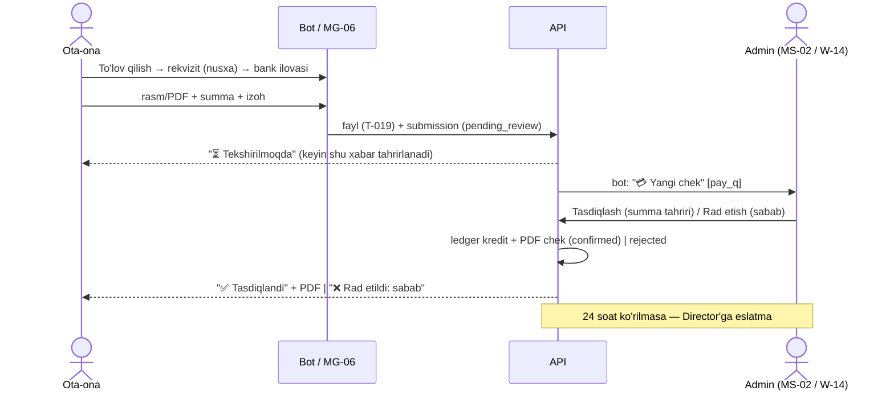
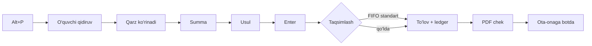
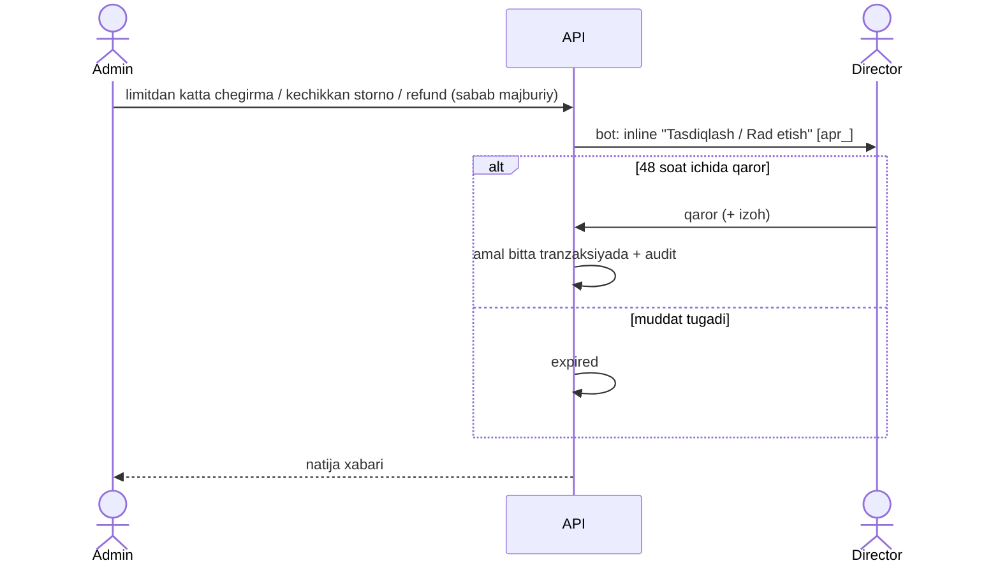
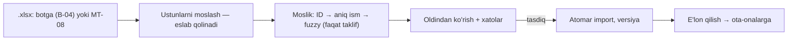

# Ekranlar xaritasi va oqimlar (T-017a)

> Manba: [11-ux.md](../11-ux.md) §2 (tuzilma), [01-requirements.md](../01-requirements.md) (FR),
> [02-roles-permissions.md](../02-roles-permissions.md) §4 (ruxsat kodlari). Har UI vazifasi shu
> hujjatdagi ekran ID'siga havola qiladi (`MT-02`, `W-14`). Ekran qo'shilsa/o'zgarsa — shu yerda.
> FR qamrovi CI'da tekshiriladi (`packages/contracts/src/ux-coverage.test.ts`): 01 dagi har FR
> §3 jadvalida bo'lishi shart.

## 0. Konvensiyalar

**ID:** `MT` — Mini App Ustoz · `MG` — Mini App Ota-ona · `MS` — Mini App xodim rejimi
(Director/Admin) · `W` — web panel · `B` — bot · `C` — umumiy (hamma kanal).

**5 holat (har ekranda majburiy, 11-ux §4.6)** — standart xatti-harakat; ekranda faqat farqi yoziladi:

| Holat       | Standart                                                                                                                             |
| ----------- | ------------------------------------------------------------------------------------------------------------------------------------ |
| Yuklanmoqda | Skeleton (ekran tuzilmasi shaklida), spinner emas; 300 ms dan tez bo'lsa ko'rsatilmaydi                                              |
| Bo'sh       | Nima uchun bo'shligi + keyingi qadam (tugma yoki matn). Masalan: "Bugun darsingiz yo'q · Jadvalni ko'rish"                           |
| Xato        | `@lg/i18n` `errorMessages[code]` + "Qayta urinish"; `requestId` "Batafsil" ichida (xabar berish uchun)                               |
| Offline     | Yuqorida ingichka chiziq "Internet yo'q"; keshdagi ma'lumot ko'rsatiladi; yozish — faqat offline navbatli ekranlarda (davomat, baho) |
| Ruxsat yo'q | 403/404 — "Bu sahifa siz uchun emas" + bosh sahifaga qaytish; deep link begona obyektga olib borsa ham shu                           |

**Ruxsat ustuni:** endpoint'dagi `@RequirePermission` kodi (bir nechtasi — vergul bilan). 🔸 — scope
service'da (o'z guruhi/farzandi). `auth` — faqat tizimga kirgan bo'lish (`@Authenticated`).

**Telegram boshqaruvlari (Mini App):** `MainButton` — ekranning asosiy amali (ustunda **qalin**);
`BackButton` — har ichki ekranda; ichki "Orqaga" tugmasi chizilmaydi.

## 1. Mini App

### 1.1 Umumiy (C)

| ID   | Ekran                | Maqsad                                       | Ma'lumotlar                      | Amallar                                       | Ruxsat |
| ---- | -------------------- | -------------------------------------------- | -------------------------------- | --------------------------------------------- | ------ |
| C-01 | Kirish (splash)      | `initData` → token (T-007)                   | —                                | avtomatik; xato bo'lsa "Botda /start bosing"  | —      |
| C-02 | Rol tanlash          | Bir nechta rol (FR-AUTH-5)                   | rollar ro'yxati                  | rolni tanlash (eslab qolinadi)                | —      |
| C-03 | Bog'lanmagan akkaunt | `TELEGRAM_NOT_LINKED`                        | —                                | "Botga qaytish" (`/start` — telefon ulashish) | —      |
| C-04 | Sozlamalar           | Rol almashtirish, bildirishnomalar, til (uz) | joriy rol, bildirishnoma turlari | rol almashtirish, turlarni yoqish/o'chirish   | auth   |
| C-05 | Fikr-mulohaza        | Xato/taklif (T-118)                          | avtomatik kontekst               | **Yuborish** (matn + skrinshot)               | auth   |

### 1.2 Ustoz (MT) — pastki menyu: Bugun · Guruhlarim · Jadval · Profil

| ID    | Ekran                    | Maqsad                                        | Ma'lumotlar                                                        | Amallar                                                                         | Ruxsat                       |
| ----- | ------------------------ | --------------------------------------------- | ------------------------------------------------------------------ | ------------------------------------------------------------------------------- | ---------------------------- |
| MT-01 | Bugun                    | Bugungi darslar, belgilanmagan davomat        | darslar (vaqt, guruh, xona, holat), ogohlantirish                  | darsni ochish → MT-02                                                           | group.view 🔸                |
| MT-02 | Davomat                  | 20 kishini ≤ 20 s (FR-ATT-1/2)                | o'quvchilar (standart ✅), oldindan "sababli" belgisi, baho ustuni | teginish ❌, uzoq bosish ⏰/📝, baho; **Saqlash (18/20 keldi)**; 3 daq tuzatish | attendance.mark 🔸🟡         |
| MT-03 | Davomat — offline navbat | Sinxronlanmagan yozuvlar (FR-ATT-6)           | navbat ro'yxati, oxirgi urinish                                    | "Hozir yuborish"                                                                | attendance.mark              |
| MT-04 | Guruhlarim               | Joriy guruhlar (Q-64)                         | guruh, kurs, o'quvchilar soni, rol (main/assistant)                | guruhni ochish → MT-05                                                          | group.view 🔸                |
| MT-05 | Guruh                    | O'quvchilar, testlar, e'lon                   | o'quvchilar, davomat %, oxirgi baholar                             | o'quvchi → MT-06; testlar → MT-07; e'lon (main) → MT-10                         | group.view 🔸                |
| MT-06 | O'quvchi profili         | Davomat, baho, izohlar (field-level 02 §3)    | davomat kalendari, baholar, izohlar (ota-ona telefoni yo'q, Q-63)  | izoh yozish (visibility)                                                        | student.view 🔸, grade.write |
| MT-07 | Testlar                  | Guruh testlari (FR-GRD-3)                     | testlar (sana, maks. ball, holat)                                  | **Test yaratish** (main); test → MT-08                                          | test.manage 🔸               |
| MT-08 | Test natijalari / import | Excel import ko'rib chiqish (FR-GRD-4, BR-35) | ustun moslash, moslik (ID → ism → fuzzy taklif), xatolar           | moslashni tasdiqlash; **Import qilish**; e'lon qilish                           | test.manage 🔸               |
| MT-09 | Jadval                   | Haftalik kalendar, o'rinbosar darslari        | haftalik darslar, o'rinbosar belgisi                               | darsni ochish → MT-02                                                           | group.view 🔸                |
| MT-10 | E'lon yuborish           | O'z guruhiga e'lon (faqat main)               | matn, fayl, oldindan ko'rish                                       | **Yuborish** (tasdiqlash oynasi)                                                | announcement.send 🔸         |
| MT-11 | Profil va oylik          | Oylik hisob (FR-SAL-4, Q-33)                  | oylar, tafsilot (o'quvchi + summa)                                 | oyni ochish                                                                     | payroll.view_own             |

### 1.3 Ota-ona (MG) — pastki menyu: Asosiy · Natijalar · To'lovlar · Ko'proq

| ID    | Ekran         | Maqsad                                 | Ma'lumotlar                                                      | Amallar                                          | Ruxsat            |
| ----- | ------------- | -------------------------------------- | ---------------------------------------------------------------- | ------------------------------------------------ | ----------------- |
| MG-01 | Asosiy        | Farzand holati bir qarashda            | farzand almashtirgich, bugun keldi/kelmadi, keyingi dars, balans | "To'lash" (qarz bo'lsa) → MG-07                  | student.view 🔸   |
| MG-02 | Natijalar     | Davomat, baho, izoh, test (FR-GRD-5)   | davomat kalendari, baholar, `guardian` izohlar, testlar, grafik  | test → MG-03                                     | results.view 🔸   |
| MG-03 | Test natijasi | Bitta test (Q-42: o'rin yo'q)          | ball, bo'limlar, guruh o'rtachasi                                | —                                                | results.view 🔸   |
| MG-04 | Hisobot       | Haftalik/oylik hisobot (FR-RPT-2/3)    | davr, davomat x/y, o'rtacha baho, izohlar, PDF                   | PDF yuklab olish                                 | results.view 🔸   |
| MG-05 | To'lovlar     | Balans, invoice'lar, tarix (FR-PAY-7)  | balans (`−Σ ledger`), invoice'lar, to'lovlar, cheklar            | chek PDF; **To'lov qilish** → MG-06              | billing.view 🔸   |
| MG-06 | To'lov qilish | Rekvizit va chek (FR-PAY-3, ≤ 5 qadam) | qarz summasi, karta rekvizitlari (nusxalash)                     | farzand → summa → rasm/PDF → izoh → **Yuborish** | payment.submit 🔸 |
| MG-07 | Chek holati   | Yuborilgan chek kuzatuvi (BR-13)       | holat (tekshirilmoqda/tasdiqlandi/rad + sabab)                   | rad etilsa — qayta yuborish                      | payment.submit 🔸 |
| MG-08 | Kela olmaydi  | Oldindan sababli xabar (FR-ATT-7)      | farzand, sana, sabab                                             | **Yuborish**                                     | absence.notify 🔸 |
| MG-09 | Murojaat      | Savol → ticket (FR-RPT-7)              | murojaatlar va javoblar                                          | **Yuborish**                                     | ticket.create     |
| MG-10 | Jadval        | Farzand jadvali                        | haftalik darslar                                                 | —                                                | student.view 🔸   |

### 1.4 Xodim rejimi (MS) — Bugun · Navbat · So'rovlar (Director) · Qidiruv

| ID    | Ekran                 | Maqsad                              | Ma'lumotlar                                         | Amallar                                                     | Ruxsat                     |
| ----- | --------------------- | ----------------------------------- | --------------------------------------------------- | ----------------------------------------------------------- | -------------------------- |
| MS-01 | Bugun / dashboard     | Ixcham KPI (FR-DASH-5)              | tushum, davomat %, belgilanmagan darslar, navbat    | ko'rsatkich → tegishli ro'yxat                              | stats.operational          |
| MS-02 | Chek navbati          | Tasdiqlash (FR-PAY-4, ≤ 3 teginish) | chek rasmi (zoom), summa, o'quvchi, dublikat ogohl. | **Tasdiqlash** (summa tahriri) / Rad etish (sabab shabloni) | payment.review             |
| MS-03 | Tasdiqlash so'rovlari | Director qarori (02 §5)             | tur, so'rovchi, sabab, payload, muddat              | **Tasdiqlash** / Rad etish (izoh)                           | approval.decide            |
| MS-04 | Qidiruv               | O'quvchini topish                   | ism/telefon/kod natijalari                          | kartochka → MS-05                                           | student.view               |
| MS-05 | O'quvchi kartochkasi  | Tez ma'lumot (qarz, ota-ona)        | guruhlar, qarz, ota-ona telefoni                    | qo'ng'iroq (`tel:`)                                         | student.view, billing.view |

## 2. Web panel (W) — Director/Admin (≥ 1280 px, `Ctrl+K`)

| ID   | Ekran                     | Maqsad                                          | Asosiy ma'lumot / amallar                                                                  | Ruxsat                          |
| ---- | ------------------------- | ----------------------------------------------- | ------------------------------------------------------------------------------------------ | ------------------------------- |
| W-01 | Kirish                    | Telefon + parol (FR-AUTH-3)                     | parol → TOTP / Telegram orqali kirish                                                      | —                               |
| W-02 | TOTP sozlash / tasdiqlash | 2FA                                             | QR, kod; zaxira kodlar (bir marta ko'rsatiladi)                                            | —                               |
| W-03 | Taklifni qabul qilish     | Parol o'rnatish (`/invite/<token>`)             | parol → W-02                                                                               | —                               |
| W-04 | Bosh sahifa               | KPI (FR-DASH-1)                                 | tushum, qarz, faol o'quvchilar, davomat %, oqim, navbat soni                               | stats.operational, finance.view |
| W-05 | O'quvchilar               | Ro'yxat, qidiruv, filtr (FR-STU-5/6)            | qidiruv (`oʻ`/`o'` normalizatsiya), qarzdor/faol/arxiv; yangi o'quvchi                     | student.view, student.manage    |
| W-06 | O'quvchi kartochkasi      | To'liq profil (FR-STU-1/2/3)                    | ma'lumot, ota-onalar, guruhlar tarixi, davomat, baho, ledger, cheklar; chegirma, muzlatish | student.view, student.manage    |
| W-07 | Bog'lanish so'rovlari     | Bot orqali kelgan noma'lum raqamlar (FR-AUTH-1) | so'rov → ota-onani tanlab bog'lash / rad                                                   | student.manage                  |
| W-08 | Lidlar                    | Kanban (FR-STU-4)                               | holatlar, sinov darsi, o'quvchiga aylantirish, manba statistikasi                          | lead.manage                     |
| W-09 | Kurslar va xonalar        | CRUD (FR-ORG-1/2)                               | ro'yxat, forma, arxiv                                                                      | course.manage                   |
| W-10 | Guruhlar                  | Guruh, ustoz, jadval (FR-ORG-3/4/6)             | holatlar, ustoz biriktirish (sana), sig'im, to'qnashuv xabari                              | group.manage, group.view        |
| W-11 | Jadval (kalendar)         | Darslar (FR-ORG-5)                              | hafta/oy; bekor qilish (sabab), ko'chirish, qo'shimcha dars, o'rinbosar; bayramlar         | lesson.manage                   |
| W-12 | Davomat                   | Guruh × sana jadvali (FR-ATT-4/5)               | o'tgan davomatni tahrirlash (sabab), belgilanmaganlar                                      | attendance.edit_past            |
| W-13 | To'lov kiritish           | ≤ 30 s, sichqonchasiz (FR-PAY-2, `Alt+P`)       | o'quvchi → qarz → summa → usul → Enter; FIFO/qo'lda taqsimlash; chek                       | payment.create                  |
| W-14 | Chek navbati              | Tasdiqlash (FR-PAY-4/5)                         | MS-02 ning keng varianti, dublikatlar                                                      | payment.review                  |
| W-15 | Qarzdorlar                | Aging, eslatmalar (FR-PAY-7, BR-22)             | filtr, saralash, kritik belgisi, eksport                                                   | billing.view                    |
| W-16 | Kassa                     | Kunlik yopish (FR-PAY-10)                       | kutilgan vs sanalgan, farq izohi                                                           | cash.close                      |
| W-17 | To'lov tafsiloti          | Storno/refund (FR-PAY-6/8/9)                    | chek, QR, ledger; storno (shu kun / so'rov), refund (Director / so'rov)                    | payment.reverse, payment.refund |
| W-18 | Chegirmalar               | Ro'yxat va berish (BR-18)                       | limitdan yuqori — so'rov (T-119)                                                           | discount.grant                  |
| W-19 | Testlar va importlar      | Natijalar (FR-GRD-3/4/6)                        | testlar, importlar tarixi, MT-08 bilan bir xil import oqimi                                | test.manage                     |
| W-20 | E'lonlar                  | Ommaviy xabar (FR-RPT-5)                        | auditoriya, matn+fayl, oldindan ko'rish, yetkazilish statistikasi                          | announcement.send               |
| W-21 | Murojaatlar               | Ticket'lar (FR-RPT-7)                           | ro'yxat, javob                                                                             | ticket.handle                   |
| W-22 | Yetib bormagan xabarlar   | Bloklangan/xato (FR-RPT-6)                      | `TelegramChatBlocked`, sabab, qayta yuborish                                               | ticket.handle                   |
| W-23 | Xarajatlar                | CRUD (FR-FIN-1)                                 | kategoriya, summa, chek rasmi                                                              | expense.manage                  |
| W-24 | P&L                       | Oylik foyda-zarar (FR-FIN-2/3)                  | tushum − xarajat − oylik                                                                   | finance.view                    |
| W-25 | Oyliklar                  | Hisob (FR-SAL-1/2/3/5)                          | shartnomalar, qoralama → tasdiqlash → to'landi, avans, tafsilot                            | payroll.manage                  |
| W-26 | Hisobotlar                | To'plam (FR-DASH-2/4)                           | daromad, aging, davomat, cohort, konversiya, ustoz samaradorligi; Excel/PDF                | stats.operational, finance.view |
| W-27 | Prognozlar                | Tushum, churn (FR-DASH-3, BR-36)                | prognoz oralig'i, xavfli o'quvchilar ("nega")                                              | finance.view                    |
| W-28 | Xodimlar                  | Admin/Ustoz (T-101)                             | qo'shish (taklif), bloklash, rol, override (02 §4)                                         | staff.manage, staff.permissions |
| W-29 | Sozlamalar                | Tizim (FR-SYS-1)                                | markaz, logo, rekvizitlar, to'lov muddati, jarima, vaqtlar, bayramlar, chegirma limiti     | settings.manage                 |
| W-30 | Audit                     | Jurnal (FR-AUD-1/2/3)                           | filtr, diff, shubhali harakatlar, xodim faolligi                                           | audit.view                      |
| W-31 | Tasdiqlash so'rovlari     | MS-03 ning web varianti                         | ro'yxat, qaror                                                                             | approval.decide                 |
| W-32 | Mening sessiyalarim       | FR-AUTH-7                                       | qurilmalar, chiqish, hammasidan chiqish                                                    | auth                            |
| W-33 | Birinchi ishga tushirish  | Usta (T-117)                                    | markaz → rekvizit → kurs → xona → ustoz → guruh → o'quvchilar → taklif                     | settings.manage                 |
| W-34 | Chek tekshirish (ommaviy) | QR → `/verify/<token>` (FR-PAY-8)               | raqam, sana, summa, holat — PII yo'q                                                       | —                               |
| W-35 | Landing                   | Ommaviy sayt (FR-SYS-4, Faza 4)                 | kurslar, lid formasi                                                                       | —                               |

## 3. FR qamrovi

| FR        | Ekran(lar)       | FR        | Ekran(lar)         | FR        | Ekran(lar)             |
| --------- | ---------------- | --------- | ------------------ | --------- | ---------------------- |
| FR-AUTH-1 | B-01, C-03, W-07 | FR-GRD-1  | MT-02, MT-06       | FR-RPT-1  | B-02, C-04             |
| FR-AUTH-2 | C-01             | FR-GRD-2  | MT-06, MG-02       | FR-RPT-2  | B-02, MG-04            |
| FR-AUTH-3 | W-01, W-02, W-03 | FR-GRD-3  | MT-07, W-19        | FR-RPT-3  | MG-04                  |
| FR-AUTH-4 | W-01, W-32       | FR-GRD-4  | MT-08, W-19, B-04  | FR-RPT-4  | C-04                   |
| FR-AUTH-5 | C-02, C-04       | FR-GRD-5  | MG-02, MT-06       | FR-RPT-5  | W-20, MT-10            |
| FR-AUTH-6 | MG-01, W-06      | FR-GRD-6  | MT-08, B-02        | FR-RPT-6  | W-22                   |
| FR-AUTH-7 | W-32             | FR-PAY-1  | MG-05, W-06        | FR-RPT-7  | MG-09, W-21            |
| FR-ORG-1  | W-09             | FR-PAY-2  | W-13               | FR-DASH-1 | W-04                   |
| FR-ORG-2  | W-09             | FR-PAY-3  | MG-06, MG-07, B-03 | FR-DASH-2 | W-26                   |
| FR-ORG-3  | W-10             | FR-PAY-4  | MS-02, W-14        | FR-DASH-3 | W-27                   |
| FR-ORG-4  | W-10             | FR-PAY-5  | MS-02, W-14        | FR-DASH-4 | W-26                   |
| FR-ORG-5  | W-11, MT-09      | FR-PAY-6  | W-17, W-18         | FR-DASH-5 | MS-01                  |
| FR-ORG-6  | W-10, W-11       | FR-PAY-7  | W-15, MG-05, B-02  | FR-AUD-1  | W-30                   |
| FR-STU-1  | W-06             | FR-PAY-8  | W-17, W-34         | FR-AUD-2  | W-30                   |
| FR-STU-2  | W-06             | FR-PAY-9  | W-17               | FR-AUD-3  | W-30                   |
| FR-STU-3  | W-06             | FR-PAY-10 | W-16               | FR-SYS-1  | W-29, W-33             |
| FR-STU-4  | W-08             | FR-SAL-1  | W-25               | FR-SYS-2  | MG-06, W-23, MT-08     |
| FR-STU-5  | W-05, MS-04      | FR-SAL-2  | W-25               | FR-SYS-3  | C-01 (barcha ekranlar) |
| FR-STU-6  | W-05             | FR-SAL-3  | W-25               | FR-SYS-4  | W-35                   |
| FR-ATT-1  | MT-01, MT-02     | FR-SAL-4  | MT-11              | FR-FIN-1  | W-23                   |
| FR-ATT-2  | MT-02            | FR-SAL-5  | W-25               | FR-FIN-2  | W-24                   |
| FR-ATT-3  | MT-02, B-02      | FR-ATT-5  | MT-01, W-12, B-02  | FR-FIN-3  | W-24                   |
| FR-ATT-4  | MT-02, W-12      | FR-ATT-6  | MT-03              | FR-ATT-7  | MG-08, MT-02           |

## 4. Bot (B)

| ID   | Oqim / xabar                  | Mazmun                                                                                  | Deep link / tugma         |
| ---- | ----------------------------- | --------------------------------------------------------------------------------------- | ------------------------- |
| B-01 | `/start` + onboarding         | Rozilik → "Raqamni ulashish" (faqat o'z kontakti) → bog'landi / Admin'ga so'rov (T-110) | "Ilovani ochish"          |
| B-02 | Bildirishnomalar              | kelmadi/kech, baho, test, to'lov holati, eslatma, hisobot — 11-ux §6 uslubi (T-109)     | har xabar — aniq ekran    |
| B-03 | Chek rasmi                    | Rasm/PDF botga → `/internal/files` → Mini App MG-06 ochiladi (summa, farzand, izoh)     | `pay_<submissionDraftId>` |
| B-04 | Excel fayl                    | Ustoz `.xlsx` yuboradi → MT-08 ochiladi                                                 | `imp_<importId>`          |
| B-05 | Tasdiqlash so'rovi (Director) | Inline "Tasdiqlash / Rad etish" → API; holat xabari tahrirlanadi                        | `apr_<requestId>`         |
| B-06 | Xodimga kirish tasdig'i       | "Telegram orqali kirish" (ADR 0006) — "Tasdiqlash" tugmasi                              | inline callback           |
| B-07 | `/help`                       | Yordam                                                                                  | —                         |

## 5. Deep link'lar (`startapp`)

Format: `https://t.me/<bot>/app?startapp=<prefiks>_<id>` (≤ 64 belgi, `[A-Za-z0-9_-]`). Mini App router
prefiksni ekranga moslaydi; obyektga ruxsat bo'lmasa — "Ruxsat yo'q" holati (11-ux §4.9).
Link boshqa rol uchun bo'lsa (masalan, Ustoz+Ota-ona `att_` ni Ota-ona rolida ochdi) va foydalanuvchida
o'sha rol bor — avtomatik shu rolga o'tiladi (tanlov ekranisiz) va rol eslab qolinadi; rol yo'q bo'lsa —
"Ruxsat yo'q". Ekran hali qurilmagan bo'lsa — bosh sahifa (`apps/miniapp/src/deep-link.ts` `SCREEN_PATHS`).

| Prefiks | Ekran | Kimga          | Manba                           |
| ------- | ----- | -------------- | ------------------------------- |
| `att_`  | MT-02 | Ustoz          | eslatma "davomat belgilanmagan" |
| `les_`  | MG-01 | Ota-ona        | kelmadi/kech xabari             |
| `res_`  | MG-02 | Ota-ona        | baho/izoh xabari                |
| `tst_`  | MG-03 | Ota-ona        | test natijasi e'loni            |
| `rep_`  | MG-04 | Ota-ona        | haftalik/oylik hisobot          |
| `bil_`  | MG-05 | Ota-ona        | qarz eslatmasi                  |
| `pay_`  | MG-06 | Ota-ona        | chek rasmi botga yuborilganda   |
| `sub_`  | MG-07 | Ota-ona        | chek tasdiqlandi/rad etildi     |
| `tik_`  | MG-09 | Ota-ona        | murojaatga javob                |
| `imp_`  | MT-08 | Ustoz          | Excel botga yuborilganda        |
| `pay_q` | MS-02 | Admin/Director | yangi chek navbatda             |
| `apr_`  | MS-03 | Director       | tasdiqlash so'rovi              |
| `stu_`  | MS-05 | Admin/Director | o'quvchi bo'yicha xabar         |

## 6. Asosiy oqimlar

### 6.1 Davomat (FR-ATT-1…3, BR-30/31)



### 6.2 Chek yuborish → tasdiqlash (FR-PAY-3/4, BR-13/15)



### 6.3 To'lov kiritish (Admin, W-13, ≤ 30 s)



### 6.4 Ota-ona onboarding (FR-AUTH-1, T-110)

```mermaid
flowchart TD
  S["/start"] --> C[Maxfiylik roziligi] --> P["Raqamni ulashish (faqat o'z kontakti)"]
  P --> F{Raqam bazada?}
  F -->|ha| L[Bog'landi → farzandlar ro'yxati → Mini App MG-01]
  F -->|yo'q| R[Admin'ga so'rov W-07 → "Markazga murojaat qiling"]
  R --> A{Admin}
  A -->|bog'ladi| L
  A -->|rad| X[Sabab bilan xabar]
```

### 6.5 Tasdiqlash so'rovi (02 §5, T-119)



### 6.6 Excel import (FR-GRD-4, BR-35)


